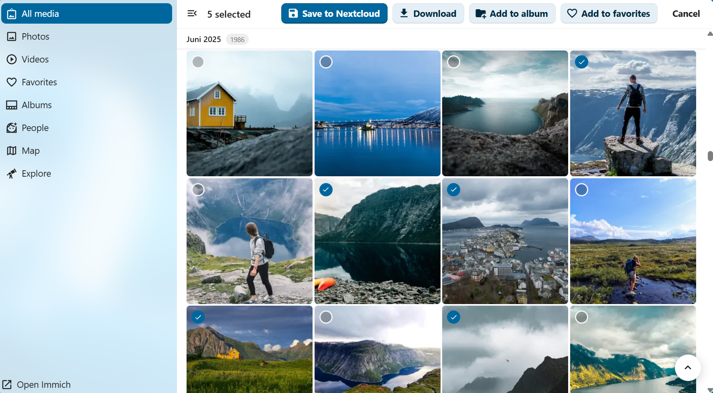
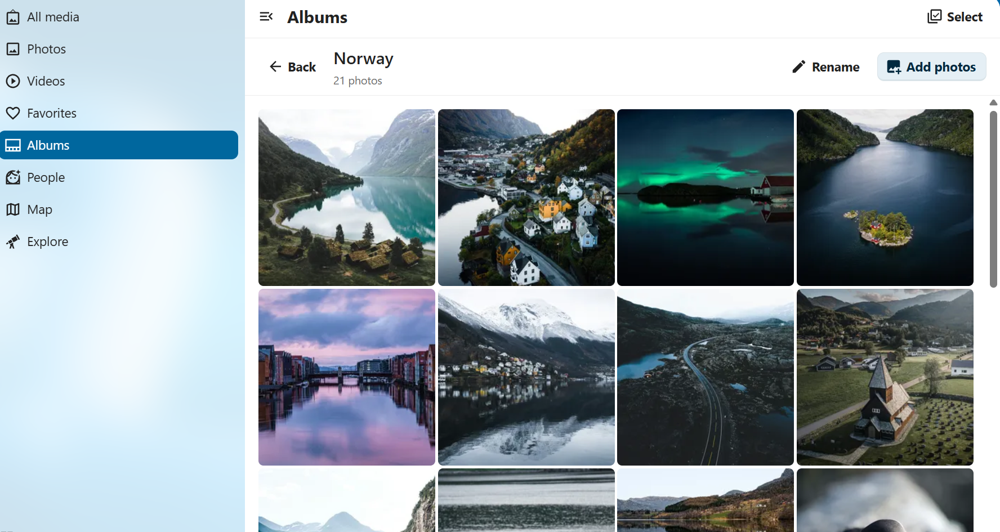
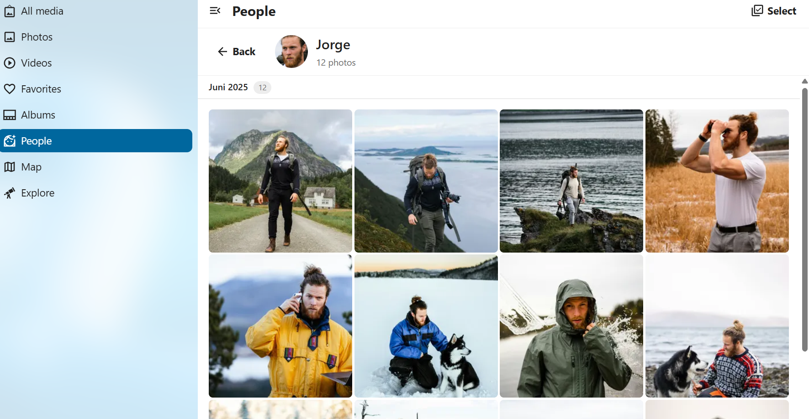

<div align="center">


# Immich Integration for Nextcloud

**Browse your [Immich](https://immich.app) photo library directly inside Nextcloud.**  
Timeline, albums, people, map, explore — all seamlessly integrated.

[](COPYING)
[](https://nextcloud.com)
[](https://immich.app)

</div>

---

## 📸 Screenshots

<table>
  <tr>
    <td align="center"><strong>Timeline</strong></td>
    <td align="center"><strong>Albums</strong></td>
    <td align="center"><strong>People</strong></td>
  </tr>
  <tr>
    <td></td>
    <td></td>
    <td></td>
  </tr>
</table>

---

## ✨ Features

| Feature | Description |
| --- | --- |
| 🖼️ **Timeline** | Lazy-loaded photo & video timeline, grouped by date with smooth infinite scroll |
| 📁 **Albums** | Browse all your Immich albums with cover thumbnails, create, rename and delete albums |
| 🗂️ **Folders** | Browse your library by original file-system folder structure (requires *Folder view* enabled in Immich settings) |
| 👤 **People** | Face recognition — explore your library by recognized person |
| 🗺️ **Map** | Interactive map of all geotagged photos with cluster markers |
| 🔍 **Explore** | Browse by city, country, state, object or tag |
| 🔎 **Lightbox** | Full-screen viewer with keyboard navigation, pinch-to-zoom and EXIF metadata panel |
| ⭐ **Favorites** | Mark and unmark photos as favorites directly from Nextcloud |
| 🗄️ **Archive** | Browse archived photos and videos; archive or unarchive a selection |
| 🔒 **Locked Folder** | Browse the Locked Folder after signing in to Immich and entering your PIN; move a selection in or out, or upload into it from Nextcloud Files (*Add to Immich Locked Folder*), which needs no PIN |
| 🗑️ **Delete** | Delete files from Immich (moved to trash if enabled) via lightbox or selection menu |
| 💾 **Save to Nextcloud** | Select photos and videos and save the originals directly to your Nextcloud Files |
| ⬆️ **Upload to Immich** | Send photos and videos from Nextcloud Files to Immich via the file action menu |
| ☑️ **Multi-select** | Select multiple assets across any view for batch operations |
| 🌍 **Translations** | German, French, Spanish, Dutch, Portuguese and Polish included |
| ⚙️ **Admin Settings** | Configure the Immich server URL per user, and sign in with the Immich account or an API key |

---

## 🔧 Requirements

- **Nextcloud** 27 or newer
- **PHP** 8.2 or newer
- A running [Immich](https://immich.app) instance (with API access enabled)

---

## 🚀 Installation

### Via Nextcloud App Store *(recommended)*

1. Open **Nextcloud → Apps → Search** for `Immich Integration`
2. Click **Install**

### Via Release Tarball (manual)

1. Download `integration_immich.tar.gz` from the [latest release](https://github.com/xXRoxXeRXx/integration_immich/releases/latest)
2. Extract into your Nextcloud `apps/` directory:
   ```bash
   tar -xzf integration_immich.tar.gz -C /path/to/nextcloud/apps/
   ```
3. Enable the app:
   ```bash
   php occ app:enable integration_immich
   ```

---

## ⚙️ Configuration

1. Open **Nextcloud → Personal Settings → Immich Integration**
2. Enter your **Immich server URL** (e.g. `https://photos.example.com`)
3. Choose how to sign in:
   - **Immich account**: sign in with your e-mail and password, or with single sign-on when
     Immich uses OAuth. The sign-in saves the server URL too.
   - **API key**: enter a key from Immich's *Account Settings → API Keys*, then click
     **Test connection** to verify and **Save**
4. The **Immich** entry now appears in the Nextcloud top navigation

### 👤 Sign-in with the Immich account

Instead of an API key, the integration can use a sign-in to your Immich account:

- Nextcloud keeps the session's token, encrypted, in your settings; never your password. It
  shows in Immich's list of devices (*Account Settings → Authorized devices*) as *Nextcloud*.
- The **Locked Folder** then asks only for your PIN: each browser gets a session of its own made
  from the account's (`POST /api/sessions`, without credentials), so that the PIN opens the folder
  in that browser alone, and signing out of Nextcloud there signs that session out.
- **Sign out of Immich** in the settings signs the account out of Immich, and with it the Locked
  Folder's sessions made from it. A saved API key is used again afterwards. Saving another server
  URL signs the account out as well.
- Single sign-on returns to the same address as the Locked Folder's (see below), so an identity
  provider that allows that one needs nothing more.
- No permissions to choose: a session may do what the account may.

### 🔑 Required Immich API Key Permissions

When creating an API key in Immich (*Account Settings → API Keys → New API key*), the following permissions are required:

| Permission | Used for |
| --- | --- |
| `album.create` | Create new albums |
| `album.delete` | Delete albums |
| `album.read` | List all albums and album contents |
| `album.update` | Rename albums |
| `albumAsset.create` | Add assets to albums |
| `albumAsset.delete` | Remove assets from albums |
| `asset.delete` | Delete assets from Immich (moves to trash if enabled) |
| `asset.download` | Download originals and archives to Nextcloud |
| `asset.read` | Timeline, asset details, EXIF metadata |
| `asset.update` | Mark / unmark favorites, archive, move into the Locked Folder |
| `asset.upload` | Upload files from Nextcloud to Immich |
| `asset.view` | Thumbnails and video streaming |
| `folder.read` | Browse the folder structure in the Folders view (requires *Administration → Features → Folder view* enabled in Immich) |
| `map.read` | Load map markers for the Map view |
| `person.read` | List recognized people and their thumbnails |
| `partner.read` | List partners and browse libraries shared with you |
| `user.read` | Validate the connection and identify the current user |

> **Tip:** Immich lets you create multiple API keys with different scopes. Creating a dedicated key for the Nextcloud integration (with only the permissions above) is recommended over using a full-access key.
>
> The connection validation on the settings page (`POST /auth/validateToken`) does not require any additional permission — it works with any valid API key.

### 🔒 Locked Folder

Immich opens its Locked Folder only to a signed-in session unlocked with the person's PIN, never
to an API key. With an API key, the **Locked Folder** view therefore asks once for an Immich
sign-in (e-mail and password, or single sign-on when Immich uses OAuth), then for the PIN (signed
in with the account in the settings, it asks for the PIN alone):

- The session's token is kept encrypted in the person's Nextcloud session only (never in the
  database). It is used for the Locked Folder alone, and only when it belongs to the same Immich
  account as the API key.
- **Lock** locks the folder again; the PIN alone opens it until the person signs out of Nextcloud
  or chooses **Sign out of Immich**. Immich also locks it after 15 minutes without use; the view
  then hides the folder's photos and videos and asks for the PIN again. A save into Nextcloud that
  the lock interrupts keeps the files it saved and leaves the rest selected for the next try.
- The session shows in Immich's list of devices (*Account Settings → Authorized devices*) as
  *Nextcloud*.
- Putting files into the Locked Folder (the selection's *Move to Locked Folder*, the Files action
  *Add to Immich Locked Folder*) works with the API key alone, without a PIN.
- **Single sign-on** returns to Nextcloud, so the identity provider must allow this redirect URI
  for Immich's OAuth client (the dialog and the settings show the exact address):
  `https://<nextcloud>/apps/integration_immich/api/v1/locked/oauth/callback`
  (with `/index.php` before `/apps` when Nextcloud has no pretty URLs).

---

## 🛠️ Development

```bash
npm install --legacy-peer-deps
npm run test:unit  # frontend unit and lifecycle tests
npm run dev      # development build (unminified)
npm run watch    # watch mode with hot rebuild
npm run build    # production build
```

The app uses **Vue 3** + **Pinia** for state management and the official `@nextcloud/*` component libraries.

---

## 🤝 Contributing

Pull requests and bug reports are welcome!  
Please open an [issue](https://github.com/xXRoxXeRXx/integration_immich/issues) for feature requests or bug reports.

---

## 📄 License

This project is licensed under the [AGPL-3.0-or-later](COPYING) license.
